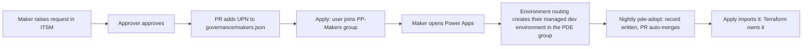

# Personal developer environment (PDE) process

Makers do not create environments. Approval is membership of one security group. The platform creates the
environment. Terraform adopts it the same night and owns it from then on. Every step is recorded in this repo.

## Flow

Decommission: run the `pde-decommission` workflow with the record name. It opens a PR whose plan shows the
destroy. Nothing is destroyed without merge and apply approval.

## The pieces

| Piece | Where | What it does |
|---|---|---|
| Approval | `governance/makers.json` | List of UPNs. A PR adding one is the request record; the reviewer is the approver. |
| PP-Makers group | `governance/makers.tf` | Entra security group whose membership mirrors `makers.json`. |
| Routing | `governance/tenant_settings.tf` | Environment routing on, scoped to PP-Makers, targeting the PDE environment group. Manual environment creation stays admin-only; routing is unaffected by that setting. |
| PDE group rules | `governance/env_groups.tf` | Sharing capped at 5 and no security groups, usage insights, Solution Checker warn, 7-day backups. Applied the moment routing creates the environment. |
| Adoption | `.github/workflows/pde-adopt.yml` | Nightly. Finds routed environments without a record, writes `environments/pde-requests/routed-<id>.json`, opens an auto-merging PR. Also reports any environment outside the process as an issue. |
| Import | `environments/pdes.tf` | Records with `environment_id` are imported; records without one are created by Terraform (exception path). |
| Decommission | `.github/workflows/pde-decommission.yml` | Removes a record and opens a non-auto-merging PR that plans the destroy. |

## What the ITSM portal does

After approval, it opens a pull request that adds the requester's UPN to `governance/makers.json`. Any ITSM tool
that can call a REST API can do this with the GitHub contents and pulls endpoints, or it can simply assign the
ticket to an admin who opens the PR by hand. The PR, not the ticket, is the record of approval here.

Removing a UPN from `makers.json` stops routing for that person. Their existing environment stays until it is
decommissioned.

## Why routing instead of Terraform creating the environment

- The provider documents Developer-environment creation as unsupported under service-principal authentication.
  Routing is done by the platform on the maker's behalf, so the limitation never applies.
- The maker needs no Developer Plan sign-up and no tenant Dataverse capacity is consumed.
- The environment is managed and inside the governed group from its first second.

## Known limits

- Routed environments are managed environments. A maker needs a premium license to **run** apps and flows in one;
  building and previewing is free. The dev tenant has no premium licenses today.
- Adoption is after the fact. Between creation and the next nightly run (at most 24 hours, or run `pde-adopt`
  by hand) the environment exists but is not yet in Terraform state. It is still governed by the group rules
  and DLP during that window.
- The adoption PR auto-merges, but the apply still waits for the production environment reviewer. Dropping that
  gate for adoption-only changes is possible later with a second, unreviewed environment used only by an
  adoption apply job.
- Pull requests opened by workflows do not trigger other workflows, so `pde-adopt` dispatches the plan workflow
  on its branch explicitly. The check runs land on the same commit and satisfy the branch ruleset.
