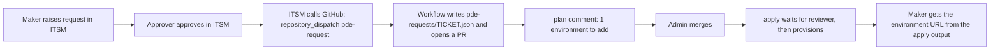

# Personal developer environment (PDE) process

Makers do not create environments. They request one. The request is approved in the ITSM portal, provisioned
by Terraform from this repository, and recorded here permanently.

## Flow



Decommissioning is the same path with `action=decommission`. The file is removed, the plan shows a destroy,
and nothing happens until the apply is approved.

## What the ITSM portal has to send

One HTTP call after approval. Authentication is a fine-grained GitHub PAT (or GitHub App) with
`contents: write` and `pull requests: write` on this repository only. Store it in the ITSM tool's secret store.

```http
POST https://api.github.com/repos/LowCodeRev/power-platform-terraform/dispatches
Authorization: Bearer <token>
Accept: application/vnd.github+json
Content-Type: application/json

{
  "event_type": "pde-request",
  "client_payload": {
    "action": "provision",
    "ticket": "REQ-0001",
    "requester_upn": "tony@lowcoderev.ai",
    "requester_object_id": "c86297e4-4aca-4bbe-b9f0-4f476e7d8b51",
    "requester_name": "Tony Stark",
    "justification": "Prototype the warranty-claims intake app before requesting a project environment.",
    "approved_by": "andy@lowcoderev.ai",
    "environment_type": "Developer"
  }
}
```

From Power Automate this is a single HTTP action. From ServiceNow it is an outbound REST message on the
approval-complete business rule. The requester's Entra object ID is available in any of those systems; the
workflow refuses requests without it.

An admin can also run the workflow by hand from the Actions tab with the same fields. That is how the first
sample request was raised.

## What gets recorded

- `environments/pde-requests/<TICKET>.json`: the request itself, including who approved it and when.
- The pull request: the plan showing exactly what was created, who merged it, who approved the apply.
- The git history: every change to every PDE, forever.
- Terraform state: the environment ID and URL, readable through `terraform output pdes`.

## Rules every PDE lives under

PDEs are placed in the **Personal Developer Environments** environment group, whose rule set is in
`governance/env_groups.tf`: sharing capped at 5 people and no security groups, usage insights on,
Solution Checker warns on import, 7-day backup retention. The tenant-wide DLP baseline applies too.

## Known limits

- **Developer type under a service principal.** The provider documents Developer-environment creation as
  preview and "not supported with service principal authentication". The first sample request is the test. If
  the apply is refused, the request is re-raised as `Sandbox`, which the service principal can create. A Sandbox
  uses 1 GB of tenant Dataverse capacity (about 10 GB is free today) and the requester is made System
  Administrator of it by Terraform.
- **Developer Plan.** A Developer environment belongs to its owner and needs the owner to hold the free Power
  Apps Developer Plan. Users who have never signed up for it may need to do so once.
- **Workflow token.** Pull requests opened with the default workflow token do not trigger the plan check. Set the
  `PDE_BOT_TOKEN` repository secret (fine-grained PAT, this repo, contents + pull requests) so the request PRs
  get their plan comment automatically.
